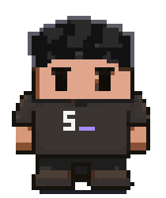

<!-- ░░░░░░░░░░░░ PANTALLA DE INICIO ░░░░░░░░░░░░ -->

  

  

  

  

  

## 🕹️ PLAYER 1

¡Hola! Soy **Javier**, desarrollador en Guatemala 🇬🇹. Me gusta construir sistemas que resuelven problemas reales: desde el servidor hasta el botón que el cliente juraba que era *"solo un cambio pequeñito"*.

En 2025 fundé **Sushell**, que empezó como **JCystem** (todo personaje tiene su skin inicial). El 5 de noviembre cumple su primer año. 🎂

El de arriba es **Kai**, mi versión de 8 bits: él sale en los videos y yo hago los deploys.

 

## 📜 FICHA DE PERSONAJE

~~~text
+======================= FICHA DE PERSONAJE =======================+

  JUGADOR ... Javier Caceres  (aka @srnovus)
  CLASE ..... Desarrollador / Fundador
  REGIÓN .... Guatemala
  NIVEL ..... 1  (Sushell cumple 1 año el 5 de noviembre)

  HP  [########..]  café al 80 %, recargando...
  MP  [######....]  paciencia ante "es un cambio pequeñito"
  XP  [#######...]  rumbo al nivel 2

  HABILIDADES
  Laravel / PHP ......... [#.........]
  Node.js ............... [##........]
  Linux / VPS ........... [####......]
  Cloudflare ............ [######....]
  Facturación FEL ....... [#########.]
  IA (Claude Code+Cursor) [#########.]
  ActivityPub ........... [#####.....]
  Centrar un div ........ [####......]  (sigue entrenando)

+==================================================================+
~~~

## 🗺️ MISIONES ACTIVAS

> **❗ QUEST PRINCIPAL · Sushell**  
> Mi empresa: software a la medida para empresas en Guatemala. Ya casi cumple su primer año, antes como JCystem.

> **❗ QUEST SECUNDARIA · Fedired**  
> La red social federada que estoy desarrollando. Progreso: cargando, y sin saltarse niveles.

  
  

**Side quests:** 🧾 portales de clientes para firmas contables y legales · 🎬 anuncios con IA para Sushell · 🛠️ dejar Fedired estable con Ordo como backend.

## 🎒 INVENTARIO

<b>⚔️ Armas</b> 

<b>🛡️ Armadura</b> 

<b>🧪 Pociones y aliados</b> 
  
  
  
  
  
  
  

## 🏆 LOGROS DESBLOQUEADOS

<table>
<tr>
<td valign="top" width="62%">

- 🏆 **Sobrevivió a un deploy en viernes** (y a otro más)
- 🏆 **Centró un div** a la primera. Según él.
- 🏆 **Le cambió el nombre a su empresa**: JCystem → Sushell
- 🏆 **Leyó la documentación**… después de probar todo lo demás
- 🏆 **"En mi máquina funciona"** y de verdad funcionaba
- 🏆 **Habla con la IA a diario** y ella le responde
- 🔒 **Bandeja de entrada en cero**: bloqueado

</td>
<td valign="top" align="center" width="38%">
   
  Viernes, 5:58 p. m., en producción
</td>
</tr>
</table>

## 📊 MARCADOR

  
  

## 👾 PAC-MAN DE CONTRIBUCIONES

Pac-Man se come mis contribuciones del último año. Los fantasmas son los bugs.

<picture>
  <source media="(prefers-color-scheme: dark)" srcset="https://raw.githubusercontent.com/srnovus/srnovus/pacman/pacman-contribution-graph-dark.svg" />
  <source media="(prefers-color-scheme: light)" srcset="https://raw.githubusercontent.com/srnovus/srnovus/pacman/pacman-contribution-graph.svg" />
  
</picture>

## 🪙 INSERT COIN PARA CONTACTARME

  
  

  
  
  
  
  

  

<b>GAME OVER? Nah.</b> <b>Hecho en la Tierra por Humanos · <i>Intelligenter humani sumus</i></b>

